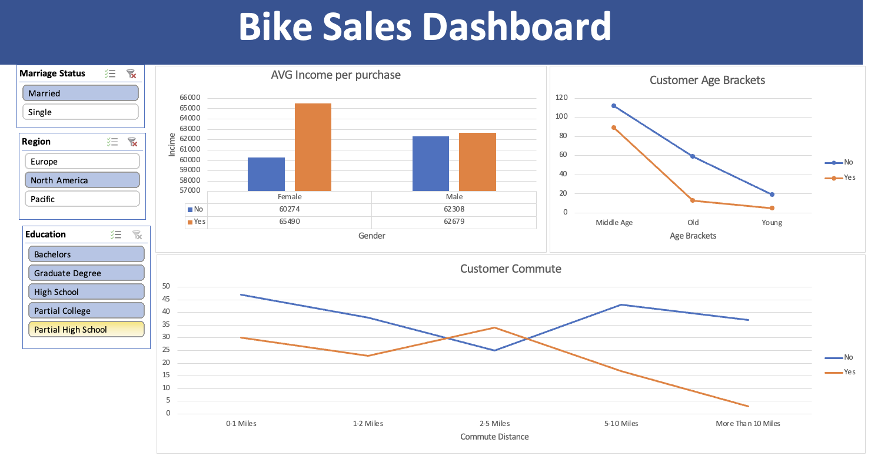

# Bike Buyers Dashboard (Excel)

Excel project: cleaning and analysing a customer dataset to see which
factors relate to buying a bike, with pivot tables, slicers and a dashboard.

## Dataset
1,000 customers: income, age, gender, marital status, children, education,
occupation, home ownership, cars, commute distance and region, plus whether
the customer purchased a bike.

## What I did
1. Cleaned the data: expanded coded values (M/F, S/M) into readable labels
   and removed duplicate rows
2. Created an age bracket column with nested IF (Young, Middle Age, Old)
3. Built pivot tables: average income by gender and purchase, purchases by
   commute distance, purchases by age bracket
4. Added slicers and combined three charts into one dashboard

## Key findings (dashboard view, 297 customers)
- Customers with a long commute (more than 10 miles) rarely buy a bike:
  3 of 40 bought, versus 34 of 59 at 2-5 miles
- Middle-aged customers buy most often: 89 of 201, versus 13 of 72 in the
  Old group
- Average income is similar for buyers and non-buyers (about 64,000 vs
  61,500), so income alone does not explain purchases

## Skills
Excel: pivot tables, slicers, nested IF, charts, dashboard design
